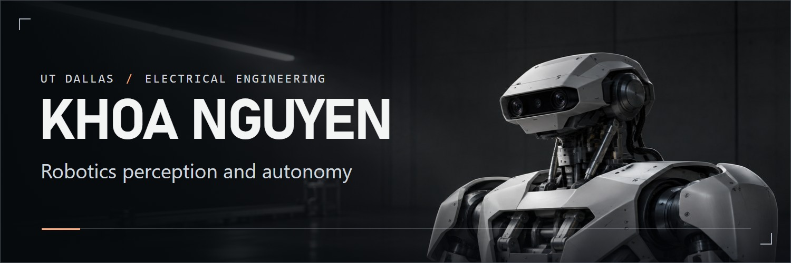
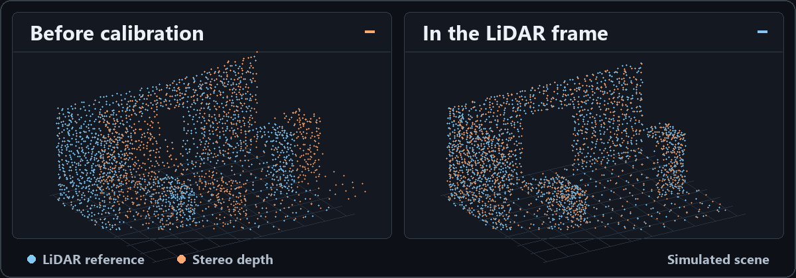

  
  
  

I’m Khoa Nguyen, an electrical engineering student at UT Dallas. I work on sensing and calibration for Project NOVA’s 1811 autonomous electric vehicle, where LiDAR and stereo cameras need to describe the same scene in a shared coordinate frame.

## Targetless LiDAR–camera calibration

I designed and prototyped a ROS 2 pipeline that estimates the rotation and translation of four ZED X stereo cameras relative to an Ouster OS1 LiDAR. It registers overlapping point clouds using scene geometry without a dedicated calibration target.

<picture>
  <source media="(prefers-reduced-motion: no-preference)" srcset="assets/profile/calibration.gif">
  
</picture>

- **Registration.** FPFH describes local 3D geometry, RANSAC uses matched features to estimate an initial pose, and ICP refines it by reducing distances between corresponding points.
- **Vehicle integration.** The NVIDIA Jetson runs Open3D registration while the Karbon hosts the LiDAR driver. The aligned clouds are visible in RViz for operator review.
- **Evaluation.** I visualized preliminary alignments and designed trials to measure repeatability, alignment error, and runtime across scenes with different sensor overlap.

[Calibration source](https://github.com/marcusnguyen2411/1811-fall-2026/blob/main/ros2_ws/src/lidar_perception/lidar_camera_registration.py) · [Technical documentation](https://github.com/marcusnguyen2411/1811-fall-2026/blob/main/ros2_ws/src/lidar_perception/README.md) · [My copy of the 1811 vehicle repository](https://github.com/marcusnguyen2411/1811-fall-2026)

## Selected engineering work

- **Project NOVA · Vehicle bring-up.** Streamlined the ROS 2 and Docker launch workflow, wired radar power and Ethernet, and used Linux network tools to diagnose vehicle connectivity.
- **VEX V5RC · Competition robotics.** Co-founded a team, helped build two robots, and redesigned motor and sensor mounts in Onshape. The team reached the finals at Katy Love of the Bots and qualified for the Texas Region 3 Championship.
- **Arduino · Embedded prototyping.** Built a C++ steering and pedal input prototype that converts analog steering readings to PWM outputs for a six-LED display.

## Technical tools

**Perception** · Open3D, OpenCV, NumPy, RViz  
**Software and systems** · Python, C++, ROS 2, Linux, Docker, Git  
**Hardware and modeling** · NVIDIA Jetson, Arduino, Onshape, MATLAB
