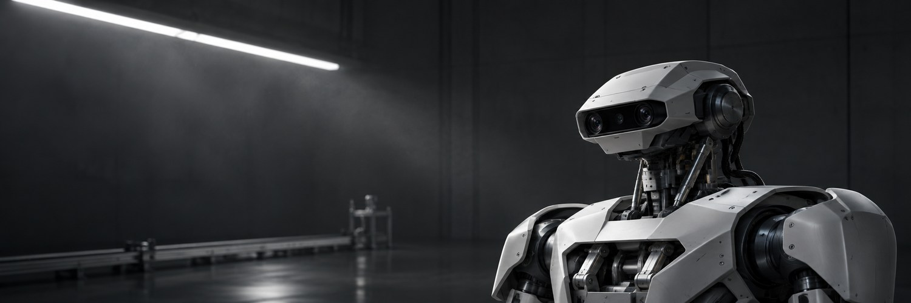

# Khoa Nguyen

**Electrical Engineering at UT Dallas · Robotics Perception and Autonomy**

I work on sensing and calibration for Project NOVA’s 1811 autonomous electric vehicle. My focus is getting LiDAR, cameras, and onboard compute to work together so the vehicle can build a consistent 3D view of its surroundings.

[Portfolio](https://minhkhoanguyen.com) · [LinkedIn](https://www.linkedin.com/in/minhkhoang/) · [Project NOVA](https://self-driving.utdallas.edu/)

## Featured project · Targetless LiDAR–camera calibration

I designed and prototyped a ROS 2 calibration pipeline that estimates the rotation and translation of four ZED X stereo cameras relative to an Ouster OS1 LiDAR. It uses geometry already present in the scene to align LiDAR and stereo-depth point clouds without a dedicated calibration target.

- **Estimate sensor poses.** Filter and downsample the point clouds, use FPFH and RANSAC for an initial alignment, then refine it with ICP.
- **Run on the vehicle.** The NVIDIA Jetson handles Open3D registration while the Karbon runs the LiDAR driver. RViz displays the aligned clouds so an operator can review a proposed pose before accepting it.
- **Evaluate the prototype.** Visualized preliminary alignments and designed trials to measure repeatability, alignment error, and runtime across different scenes and levels of sensor overlap.

[Calibration source](https://github.com/marcusnguyen2411/1811-fall-2026/blob/main/ros2_ws/src/lidar_perception/lidar_camera_registration.py) · [Technical documentation](https://github.com/marcusnguyen2411/1811-fall-2026/blob/main/ros2_ws/src/lidar_perception/README.md) · [My copy of the 1811 vehicle repository](https://github.com/marcusnguyen2411/1811-fall-2026)

## Selected engineering work

- **Vehicle integration · Project NOVA.** Streamlined the ROS 2 and Docker launch workflow, wired radar power and Ethernet, and used Linux network tools to diagnose communication issues on the onboard computer.
- **Competition robotics · VEX V5RC.** Co-founded a team, helped build two competition robots, and redesigned motor and sensor mounts in Onshape. The team reached the finals at Katy Love of the Bots and qualified for the Texas Region 3 Championship.
- **Embedded prototyping · Arduino.** Built a C++ steering and pedal input prototype that maps analog steering readings to PWM outputs for a six-LED display.

## Technical tools

**Perception** · `Open3D` · `OpenCV` · `NumPy` · `RViz`  
**Software and systems** · `Python` · `C++` · `ROS 2` · `Linux` · `Docker` · `Git`  
**Hardware and modeling** · `NVIDIA Jetson` · `Arduino` · `Onshape` · `MATLAB`
